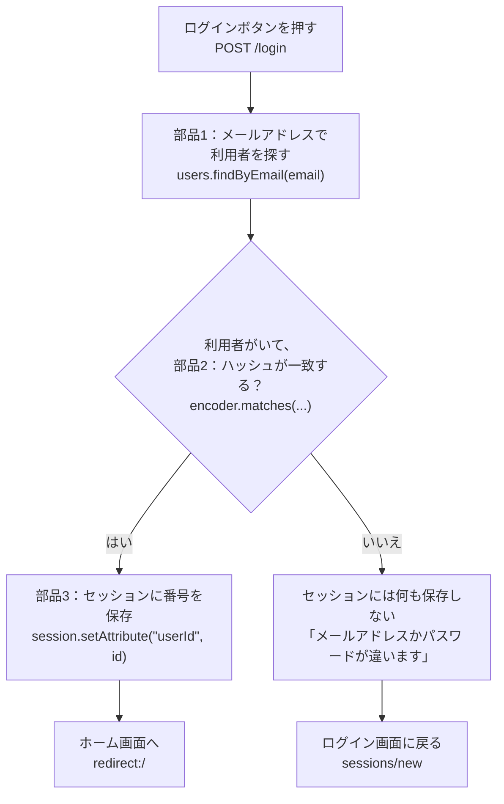
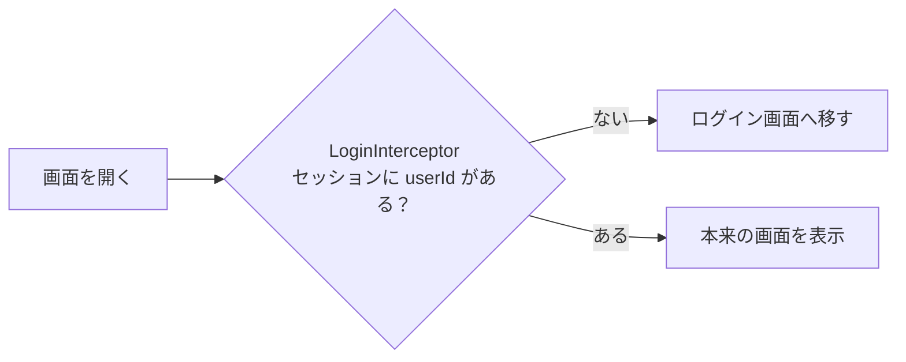

# ログイン機能（Java / Spring Boot）

「共通ログイン機能 他言語対応ガイド」の Spring Boot の章に沿って作ったログイン機能です。

## ログインの4つの部品とファイル

ログインは、どの言語でも「テーブル、ハッシュ、セッション、守り」の4つの部品でできています。

| 部品 | やること | ファイル | Railsでは |
|---|---|---|---|
| 1. テーブル | 利用者を保存する（id、name、email、パスワードのハッシュ） | `User.java`、`UserRepository.java` | `users` テーブルと `User` モデル |
| 2. ハッシュ | パスワードをハッシュして保存し、ログイン時に比べる | `Seed.java`、`SessionsController.java` | `has_secure_password` |
| 3. セッション | ログインできたら利用者の番号を保存する。ログアウトで消す | `SessionsController.java` | `session[:user_id]` |
| 4. 守り | 未ログインならログイン画面へ移す | `LoginInterceptor.java`、`WebConfig.java`、`CurrentUserAdvice.java` | `before_action`、`current_user` |
| 画面 | ログイン画面、ホーム画面、ログアウトボタン | `templates/` 以下 | ERB |

Javaのファイルはすべて `src/main/java/com/example/messageapp/` にあります。

## ログインボタンを押したときの流れ



### 「誤ったパスワードのとき、どの行に進むか」

`SessionsController.java` の `create` メソッドで説明します。

1. `users.findByEmail(email)` で利用者は見つかる（部品1）
2. `if` の中の `encoder.matches(password, ...)` が `false` になる（部品2）
3. `if` の中に入らないので、`session.setAttribute` は実行されない（部品3には何も保存しない）
4. `model.addAttribute("alert", "メールアドレスかパスワードが違います")` の行に進む
5. `return "sessions/new"` でログイン画面に戻る

メールアドレスが登録されていない場合も、`user.isPresent()` が `false` になり、同じ4と5の行に進みます。同じ文を出すのは、どのメールアドレスが登録済みかを外部の人に教えないためです。

## 守りの仕組み



- `WebConfig.java` で、守りを全画面（`/**`）に効かせています。
- ログイン画面（`/login`）は守りから除外しています。除外しないと、ログイン画面を開くたびにログイン画面へ移されて「リダイレクトが多すぎる」エラーになります。

## 動かし方

**必要なもの:** Java 17以上（JDK）。チームでは Temurin 25 にそろえています。

```bash
./mvnw spring-boot:run
```

初回は、Maven と部品（ライブラリ）のダウンロードで数分かかります。Windows では `mvnw.cmd spring-boot:run` を使います。

起動したら、ブラウザで `http://localhost:8080` を開きます。

**テスト用の利用者**（`Seed.java` で起動時に登録されます）

| メールアドレス | パスワード |
|---|---|
| `student1@example.com` | `password` |

## 完成の確認（ガイドの4つの操作）

| 試すこと | 正しい結果 |
|---|---|
| `student1@example.com` と `password` でログインする | トップ画面に「学生1さん」と出る |
| 違うパスワードでログインする | 「メールアドレスかパスワードが違います」と出て、ログイン画面に戻る |
| ログアウトを押す | ログイン画面に戻る |
| ログアウト後に、トップのURL（`http://localhost:8080/`）を直接開く | ログイン画面に移る |

**ハッシュの確認:** `http://localhost:8080/h2-console` を開き、JDBC URL に `jdbc:h2:file:./data/app`、User Name に `sa` を入れ、Password は空欄のまま接続します。`SELECT * FROM USERS;` を実行し、`PASSWORD_DIGEST` 列が `password` ではなく `$2a$10$...` のような長い文字列になっていれば、部品2が動いている証拠です。

## ガイドから追加・変更した点

| 内容 | 理由 |
|---|---|
| `HomeController.java` を追加 | ログイン後に移るトップ画面（`/`）が必要なため |
| `/h2-console/**` を守りから除外し、H2コンソールを有効化 | ガイドの「データベースの中身を見て、パスワードがハッシュになっていることを確かめる」を行うため。開発中だけの機能 |
| データベースのユーザー名を `sa` に固定 | 指定しないと空欄になり、H2コンソールの初期値（`sa`）では接続できなかったため |
| Spring Boot 3.5.16 を使用 | Java 25 に対応した Spring Boot 3 系の最新版のため |
| Maven Wrapper（`mvnw`）を追加 | メンバーが Maven を自分で入れなくても起動できるようにするため |
| ログイン失敗時に、入力したメールアドレスを残す | 入力し直す手間を減らすため |
| 入力欄に `required` を付けた | 空欄のまま送信しないようにするため。本当のチェックはサーバー側で行う |
| 試作版のデザイン（`static/css/style.css`）を使った | チームで作った試作版の見た目を引き継ぐため |

## よくあるエラー

| 起きたこと | 主な原因 | 直し方 |
|---|---|---|
| リダイレクトが多すぎる | ログイン画面を守りから除外していない | `excludePathPatterns` に `/login` があるか確認 |
| 正しいパスワードで入れない | 初期データがない、またはハッシュせずに保存した | `data/` フォルダを消して起動し直す |
| Whitelabel Error Page のまま止まる | `/error` を守りが止めている | `excludePathPatterns` に `/error` を足す |
| CSSが当たらない | `/css/**` を守りが止めている | `excludePathPatterns` に `/css/**` を足す |
