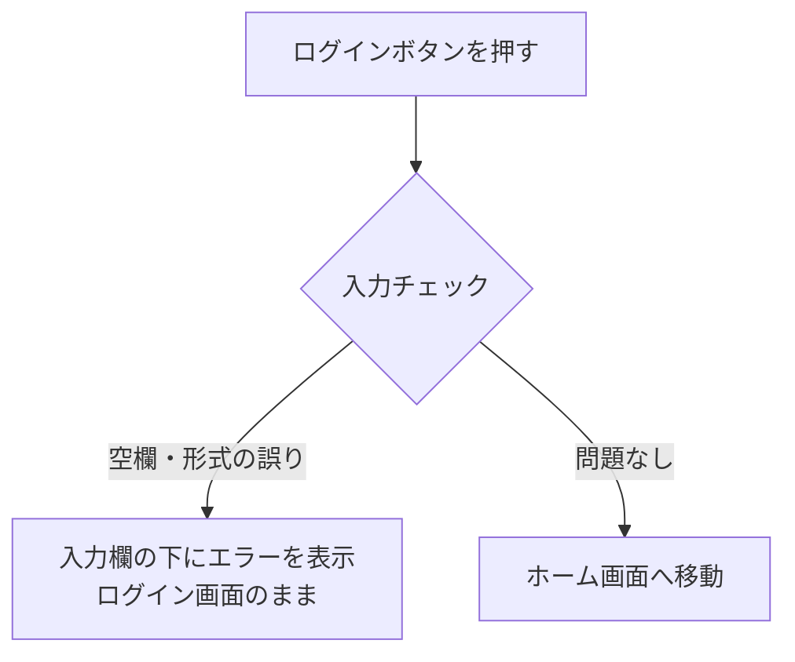

# ログイン画面

画面遷移図の「ログイン画面」にあたる部分です。

## ファイル構成

| ファイル | 役割 |
|---|---|
| `index.html` | 画面の部品（入力欄、ボタン）を並べる |
| `css/style.css` | 色、大きさ、配置などの見た目を決める |
| `js/login.js` | 入力チェックやボタンを押したときの動きを決める |
| `home.html` | ログイン後の移動先（今は確認用の仮ページ） |

HTML（構造）、CSS（見た目）、JavaScript（動き）をファイルごとに分けています。役割ごとに分けておくと、デザイン担当と処理担当が別々に作業しても、同じファイルを同時に書き換えずに済みます。

## ログインボタンを押したときの流れ

入力チェックの内容は次のとおりです（`js/login.js` の `checkEmail` と `checkPassword`）。

| 項目 | チェック内容 | エラーメッセージ |
|---|---|---|
| メールアドレス | 空欄ではないか | メールアドレスを入力してください |
| メールアドレス | 「文字@文字.文字」の形か | メールアドレスの形式が正しくありません |
| パスワード | 空欄ではないか | パスワードを入力してください |
| パスワード | 8文字以上か | パスワードは8文字以上で入力してください |

## 工夫した点

- **エラーを日本語で表示する:** ブラウザ標準のチェックは表示がブラウザごとに違うため、`novalidate` で止めて自前で表示しています。
- **入力し直すとエラーが消える:** 直した欄のエラーだけ消えるので、どこが残っているか分かりやすくなります。
- **パスワードの表示切り替え:** 打ち間違いを確認できるようにしています。
- **スマホ対応:** 入力欄の文字を16px以上にして、iPhoneで入力時に画面が勝手に拡大されないようにしています。

## まだできていないこと

- **本人確認:** 今は入力の形式しか確認していません。メールアドレスとパスワードが登録済みのものと一致するかは、サーバーを作ってから確認します（`js/login.js` の `TODO` の部分）。
- **ログイン状態の保持:** 今は `home.html` を直接開くと、ログインしていなくても見えてしまいます。これもサーバー側の仕組みで防ぎます。

## 想定される質問

- **Q. ブラウザで入力チェックをしていれば安全ですか？**
  A. いいえ。ブラウザ側のチェックは、入力ミスをすぐ知らせるためのものです。ブラウザのプログラムは利用者が書き換えられるので、安全のための確認は必ずサーバー側でも行います。
