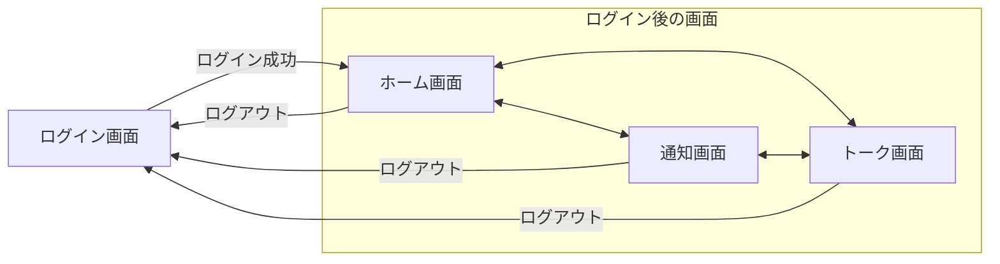

# 画面遷移図

メッセージアプリの画面と、画面間の移動をまとめた設計図です。

## 画面一覧

| 画面 | 役割 |
|---|---|
| ログイン画面 | アプリを開いて最初に表示する |
| ホーム画面 | ログイン後に最初に表示する |
| 通知画面 | 通知を確認する |
| トーク画面 | メッセージを送受信する |

## 遷移一覧

| 移動元 | 移動先 | きっかけ |
|---|---|---|
| ログイン画面 | ホーム画面 | ログイン成功 |
| ホーム画面 | 通知画面、トーク画面 | 画面を切り替える操作 |
| 通知画面 | ホーム画面、トーク画面 | 画面を切り替える操作 |
| トーク画面 | ホーム画面、通知画面 | 画面を切り替える操作 |
| ホーム画面、通知画面、トーク画面 | ログイン画面 | ログアウト |

## チームで決めること

- ログインに失敗したときの動作（例: ログイン画面のままエラーを表示する）
- 新規登録画面が必要か
- 通知をタップしたときに、該当のトークを直接開くか
